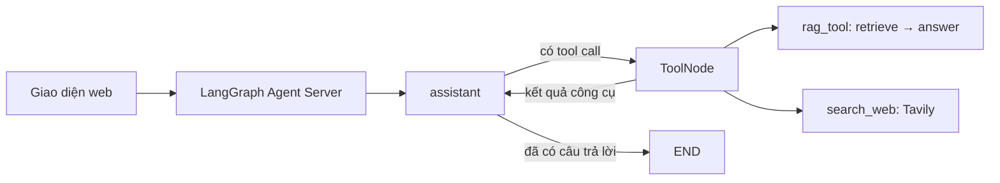

# Chatbot hỗ trợ tâm lý — LangGraph

Giao diện tiếng Việt theo ảnh tham chiếu: thanh bên trắng, nền tím nhạt, tin nhắn trợ lý trắng, tin nhắn người dùng hồng, ô nhập và nút Gửi ở dưới. Giao diện tự thích ứng trên điện thoại. Biểu tượng trái tim là SVG thay thế; có thể thay `frontend/logo.svg` bằng logo chính thức nếu có.

## Chạy trên Windows

Yêu cầu Python 3.11 trở lên.

```powershell
python -m venv .venv
.venv\Scripts\python.exe -m pip install -r requirements.txt
```

Nếu chưa có `.env`, sao chép `.env.example` thành `.env` rồi điền `GROQ_API_KEY`. Điền thêm `TAVILY_API_KEY` để tìm kiếm web. Giữ lại khóa hiện có nếu đã cấu hình; không đưa khóa vào mã giao diện.

```powershell
.venv\Scripts\python.exe start_langgraph.py
```

Mở **http://127.0.0.1:2024**. Cũng có thể nhấp đúp `run_langgraph.bat`. Các lệnh `start_api.py`, `run_api.bat`, `run_api.ps1` chuyển về cùng máy chủ LangGraph. Không chạy Live Server hoặc `uvicorn main:app`: các API threads/runs do LangGraph Agent Server cung cấp.

Trong VS Code, cũng có thể mở `agent.py` rồi chọn **Run Python File** để khởi động web, hoặc chạy `.\run_langgraph.bat` trong terminal PowerShell. Giữ terminal chạy trong lúc sử dụng; nhấn Ctrl+C để dừng. Nếu chạy bằng cách nhấp đúp và có lỗi, cửa sổ sẽ giữ lại thông báo để kiểm tra.

Chương trình tự mở trình duyệt khi web đã sẵn sàng. Nếu không muốn tự mở, chạy `.\run_api.bat --no-browser`. Nhật ký khởi động được lưu tại `.cache/last_startup.log`. Nếu chatbot đã chạy, lệnh khởi động sẽ sử dụng lại máy chủ đang có.

Để khởi động lại, kể cả khi máy chủ đang chạy nền, dùng:

```powershell
.\run_langgraph.bat --restart
```

Cũng có thể nhấp đúp `restart_langgraph.bat`. Lệnh này dừng cây tiến trình LangGraph đã xác định thuộc môi trường `.venv` của dự án rồi chạy lại; không xóa lịch sử hoặc dừng các chương trình Python khác. Nếu đang có terminal máy chủ, có thể nhấn Ctrl+C để dừng rồi chạy lại `run_langgraph.bat`. Giữ terminal mới mở trong lúc dùng chatbot.

Enter gửi tin; Shift+Enter xuống dòng. Nút “Cuộc trò chuyện mới” mở thread riêng. Tải lại cùng tab khôi phục hội thoại từ máy chủ. Tab chỉ lưu mã thread trong `sessionStorage`, không lưu nội dung tin nhắn trong trình duyệt. Tạo hội thoại mới không xóa thread cũ trên máy chủ.

## Kiến trúc



- `agent.py`: `StateGraph(MessagesState)`, node trợ lý bất đồng bộ, rẽ nhánh công cụ và vòng lặp trả lời.
- `graph.py`: xuất đồ thị `chatbot` cho Agent Server. Runtime quản lý checkpoint và lịch sử theo thread; không gắn checkpointer riêng vào graph triển khai.
- `Rag_tool.py`: đồ thị RAG lấy ngữ cảnh từ `Stress.pdf` rồi tạo câu trả lời có chỉ dẫn nguồn/trang. FAISS và Hugging Face hỗ trợ truy xuất; Groq cung cấp mô hình ngôn ngữ. Không còn `RetrievalQA` trong luồng ứng dụng.
- `main.py`: chỉ phục vụ giao diện qua cấu hình `http.app` trong `langgraph.json`. Frontend gọi `POST /threads`, `GET /threads/{id}/state`, `POST /threads/{id}/runs/wait` trực tiếp, thay cho endpoint `/chatbot` cũ.
- `frontend/`: HTML/CSS/JS thuần, không cần Node.js hoặc bước build. Giao diện hiển thị nội dung dưới dạng văn bản và liên kết an toàn.

LangGraph điều phối toàn bộ luồng xử lý; HTML/CSS/JS vẫn là phần giao diện, các thư viện mô hình và tìm kiếm vẫn là tích hợp cần thiết. Đây không phải mô hình AI chạy ngoại tuyến: trả lời cần kết nối Groq, tìm web cần Tavily. Lần tra cứu PDF đầu có thể tải mô hình embedding nên sẽ chậm hơn. `langgraph dev` phục vụ phát triển trên máy cá nhân, dữ liệu runtime nằm trong `.langgraph_api/`; không dùng cấu hình dev này làm dịch vụ công khai.

Các notebook và script bài tập cũ (`chain.py`, `promt.py`…) được giữ để tham khảo, không tham gia luồng chatbot. `LangServe.py` là tên tương thích để truy cập app giao diện, không cung cấp API LangServe riêng.

## Kiểm tra

```powershell
.venv\Scripts\python.exe -m unittest discover -s tests -v
```

Các kiểm tra dùng mô hình và công cụ giả để xác minh vòng gọi công cụ, bộ nhớ phân tách theo thread, đồ thị RAG và phục vụ giao diện mà không gọi API tính phí.

Tài liệu tham khảo: [Custom routes trong Agent Server](https://docs.langchain.com/langsmith/custom-routes), [rẽ nhánh công cụ với tools_condition](https://reference.langchain.com/python/langgraph.prebuilt/tool_node/tools_condition).
